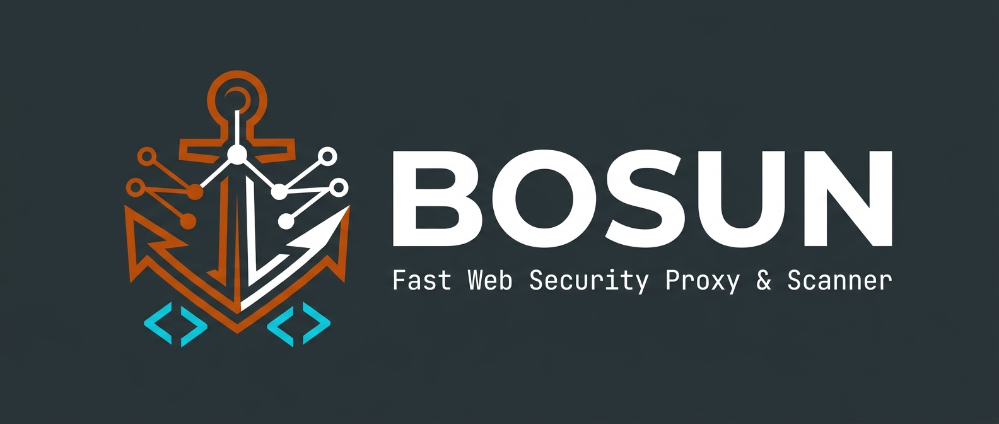

<p align="center"></p>

# Bosun

A free, fast, low-memory intercepting proxy and dynamic application security testing (DAST) toolkit, written in
Rust. The goal is one tool that covers what Burp Suite Professional and OWASP ZAP do (intercepting proxy,
Repeater, Intruder, Sequencer, an out-of-band interaction server, passive and active scanning), for homelabbers,
hobbyists and individual security testers.

> The bosun is the ship's officer who inspects the hull and rigging and reports what is wrong before the
> weather finds it. Bosun does that for web applications.

**Status: early (Phase 3 in progress; no tagged release yet).** The proxy, history, intercept, match-and-replace,
scope, site map, CA, accounts, the web UI, the Repeater, the Decoder and Comparer and the first engagement helpers
work. Intruder, Sequencer, the scanner and the OAST server are next; see [roadmap.md](roadmap.md). What has landed
is in [docs/releases.md](docs/releases.md).

## What works today

- **Intercepting proxy**: HTTP/1.1 and HTTP/2, HTTPS interception with a per-install CA, WebSockets (recorded
  message by message), streaming responses (SSE, large downloads), upstream HTTP and SOCKS5 proxies, TLS
  pass-through for pinned hosts, invisible (transparent) proxying for plain HTTP and for HTTPS (the host comes from the SNI, the port from the redirect on Linux,
  port 443).
- **Intercept**: hold requests and/or responses, edit them as raw text, forward or drop; in-scope only by default.
- **Match and replace** on request/response first lines, headers and bodies (literal or regex).
- **HTTP history** with full-text search (FTS5 trigram), a virtualised list that stays fast at millions of rows,
  server-side sorting and paging, a column chooser, colour highlights, bulk tags, raw/headers/hex/render views,
  automatic decoding of gzip, deflate, Brotli and zstd bodies, the original message kept next to the edited one.
  A **query language** (`host:example.com status:4xx -ext:png (login or "sign in")`) with completion, recent
  queries and **saved filters**: see [docs/query-language.md](docs/query-language.md).
- **Organizer**: save requests with a status and a note.
- **Repeater**: raw requests sent byte for byte over HTTP/1.1 or HTTP/2 (opt-in connection reuse, single-packet
  batches), tabs saved in the project, a WebSocket mode, a message editor, response diff. Every send goes through
  the scope gate.
- **Decoder and Comparer**: encode, decode, compress and hash chains (MD5, SHA-1, SHA-2), smart decode, and a diff of two items. `bosun decode` runs the same chains from the command line, offline. "Send to Decoder"
  and "Send to Comparer" are in the History menu.
- **Export**: copy as cURL (POSIX shells and PowerShell), snippets in Python, JavaScript and Go, and HAR 1.2. Cookie
  and authorization values are written as `REDACTED` unless you tick "Keep cookies and authorization values".
- **Findings panel**: comments, scripts, links, forms, references and parameters found in a message, and a CSRF
  proof of concept page for a request (downloaded as an attachment with a sandboxing CSP). The **Host analysis**
  panel counts the distinct endpoints and parameters of a host across the whole history.
- **Target**: site map and a scope editor (include/exclude rules). Every active tool sends only to in-scope
  targets.
- **Open browser**: launches Chromium/Chrome with its own profile, already using the proxy and trusting the CA by
  key pin, so the CA never has to be installed anywhere.
- **Front ends**: web UI (container or local), desktop app (Tauri), CLI. A TUI is planned. All of them use the
  same authenticated API.

## Build and run

`scripts/bosun.sh` wraps the steps below: `deps` (Linux packages for the desktop app, uses sudo), `build
[engine|desktop|all]`, `run [engine|desktop] [-- ARGS]`, `install [PREFIX]`, `container [TAG]`, `up`/`down`
(compose) and `check` (clippy, tests, web check). Run `scripts/bosun.sh help`. It is a bash script, so on Windows
use the manual steps (or WSL or Git Bash, which are untested).

### Prerequisites

- **Rust** through [rustup](https://rustup.rs). The toolchain is pinned in `rust-toolchain.toml` (1.100.0, with
  clippy and rustfmt); rustup installs it on the first `cargo` run. The workspace uses Rust 2024 and forbids
  `unsafe`. A C toolchain and linker are needed as for any Rust project (build-essential on Linux, Xcode command
  line tools on macOS, the MSVC build tools on Windows).
- **Node and npm** for the web UI in `web/`. CI uses Node 26; `scripts/bosun.sh` says Node 20 or newer, which is
  not tested here. Without Node you can still build the engine, but the binary then serves a placeholder page
  (the API still works).
- The engine needs no system libraries: TLS is not OpenSSL (OpenSSL is banned in `deny.toml`).

### The web UI and how it gets into the binary

```sh
npm --prefix web ci && npm --prefix web run build      # writes web/dist
```

`crates/bosun-api/build.rs` embeds `web/dist` into the binary at compile time when `web/dist/index.html` exists. If
it does not, it embeds a placeholder page. Set `BOSUN_WEB_DIST=/path/to/dist` to embed a build from another path
(the Dockerfile does). Rebuild the web UI before `cargo build` whenever it changes. While working on the UI,
`npm --prefix web run dev` starts Vite.

### Linux, macOS and Windows: the engine

The same steps on all three (use PowerShell or any shell on Windows):

```sh
npm --prefix web ci && npm --prefix web run build
cargo build --release -p bosun
./target/release/bosun serve            # target\release\bosun.exe serve on Windows
```

The first run prints a link with a one-time setup code. Open it to create the admin account. Then:

- point a browser at the proxy, `127.0.0.1:8080`, or use **Settings → Open browser**;
- for your own browser, download the CA from `http://bosun/` (through the proxy) and import it **into a
  separate browser profile only**.

What CI covers per OS: Linux builds, runs clippy, the tests, the web checks, the end-to-end suite, the fuzz targets,
the container image and the desktop shell. Windows runs `cargo test` only. macOS is not built or tested in CI at
the moment (the job is paused, see Housekeeping in [roadmap.md](roadmap.md)), so macOS builds are expected to
work but are not verified. Open browser launches Chromium/Chrome; its behaviour on Windows and macOS has not
been checked for this README.

### Desktop app (`bosun-desktop`)

```sh
npm --prefix web run build && cargo build --release -p bosun-desktop
```

`bosun-desktop` (Tauri 2) is not a default workspace member, because it needs the platform's webview. That is why
plain `cargo build` and `cargo test` skip it; name it with `-p bosun-desktop`, and avoid `--workspace` unless the
webview libraries are installed. The web UI must be built first (`tauri.conf.json` takes `web/dist`).

| OS | Webview | You need |
|---|---|---|
| Linux | WebKitGTK 4.1 | `libwebkit2gtk-4.1-dev libgtk-3-dev libayatana-appindicator3-dev librsvg2-dev` (Debian/Ubuntu names; `scripts/bosun.sh deps` also knows dnf and pacman) |
| Windows | WebView2 | The Microsoft Edge WebView2 runtime (preinstalled on current Windows 10 and 11) |
| macOS | WKWebView | Nothing extra; it ships with the system |

CI builds the desktop shell on Linux only. The Windows and macOS rows describe how Tauri works and have not been
built or tested in this repository.

### Container

```sh
docker compose -f compose.example.yaml up -d
docker compose -f compose.example.yaml logs bosun    # the setup link
```

or `scripts/bosun.sh up` (builds first), `scripts/bosun.sh container` for the image alone (`bosun:local`). The
`Dockerfile` builds the web UI and the engine in two stages and ends in a distroless nonroot image (proxy on 8080,
UI and API on 8090, data in `/data`). Both ports are published on 127.0.0.1 only. Read the comments in
`compose.example.yaml` and `docker/bosun.toml` before exposing either on a network.

### Tests

See [docs/testing.md](docs/testing.md) for the details.

| What | Run |
|---|---|
| Rust unit, integration and property tests | `cargo test` |
| Lints | `cargo clippy --all-targets -- -D warnings`, `cargo fmt --all --check` |
| Web type check and layout/tokeniser/diff tests | `cd web && npm run check && npm test` |
| End to end (Playwright, a real `bosun serve`) | `cargo build -p bosun`, then `cd e2e && npm ci && npx playwright install chromium && npm test` |
| Fuzzing (nightly and `cargo install cargo-fuzz`) | `cd fuzz && cargo +nightly fuzz run <target> -- -max_total_time=30` |
| Dependencies | `cargo deny --workspace check` |

`scripts/bosun.sh check` runs clippy, `cargo test` and the web check.

## Commands

| Command | |
|---|---|
| `bosun serve [--project NAME] [--proxy ADDR] [--listen ADDR]` | Run the proxy and the UI/API |
| `bosun doctor` | Check the install (permissions, keys, CA trust, exposure) |
| `bosun ca export [--der] [--out FILE]`, `ca info`, `ca rotate [--permit-domain D]...` | The CA certificate, its fingerprints and expiry; replace it, optionally limited to some domains |
| `bosun user add NAME [--role viewer\|tester\|admin]`, `user passwd NAME`, `user totp-reset NAME`, `user list` | Accounts (password on stdin) |
| `bosun user role NAME ROLE`, `user delete NAME [--yes]`, `user sessions NAME [--revoke]`, `user list --json` | More account administration |
| `bosun token create USER --name N [--scope read\|full] [--expires-days D]`, `token list [USER]`, `token revoke ID` | API tokens (`--json` on create and list) |
| `bosun project list\|create\|rename\|delete\|export\|import\|backup` | Projects in the data directory; refuses (exit 3) while a running Bosun has the project |
| `bosun audit [-n N] [--action P] [--user U] [--json]` | The audit log |
| `bosun serve --no-ui`, `bosun completions SHELL`, `bosun man --out DIR` | Record without the UI; shell completions; man pages |
| `bosun example-config` | An annotated configuration file |
| `bosun login --server URL [--profile NAME] [-u USER]` | Sign in to an engine and keep an API token in a profile (password on stdin) |
| `bosun status [--server URL] [--profile NAME] [--json]` | Show the engine you are signed in to |
| `bosun repeater send TARGET [FILE] [--http2] [--count N] [--mode sequential\|parallel\|single-packet] [-i] [--json]` | Send a raw request file (or stdin) through the Repeater; exit code 3 when the scope refused it, 4 when nothing came back |

Which CA to use: the default CA (valid for any name) is for the launched browser, which pins it without
installing it. For a device you have to install a CA on (a phone, a VM), run
`bosun ca rotate --permit-domain target.example --permit-domain other.example` first: the new CA is accepted only
for those domains and never for IP addresses, so a leaked key cannot impersonate anything else to that device.
The CA lasts three years; `doctor` and the Settings page warn 30 days before it ends. Rotate, restart Bosun and
replace the installed copy (`bosun ca export`). The old certificate stays in `ca/previous/`, its key is deleted.

Configuration: `--config FILE` or `BOSUN_CONFIG`. Data: `--data-dir`, `BOSUN_DATA_DIR`, else the platform data
directory. The data key: `BOSUN_DATA_KEY` (base64) or `BOSUN_DATA_KEY_FILE`, else `<data>/data.key`.

Server mode (containers):

- `GET /healthz` answers `ok` without authentication, and `bosun healthcheck` exits 0 when the configured UI/API
  listener answers it (no curl needed; with `api.tls` it only checks that the port accepts connections).
- Setup without a terminal: `BOSUN_ADMIN_USER` and `BOSUN_ADMIN_PASSWORD_FILE` create the first admin at start-up, and
  `BOSUN_BOOTSTRAP_TOKEN_FILE` (a file holding a token of at least 32 characters) adds a full API token for it. Both
  are audited and ignored once any user exists.
- `password_file` replaces `password` in `proxy.auth` and `proxy.upstream`.
- `BOSUN_LOG_FORMAT=json` writes one JSON object per log line.
- `metrics_listen = "10.0.0.5:9090"` serves Prometheus `/metrics` on its own listener (off by default, no
  authentication).
- The memory budget defaults to half the container's cgroup memory limit (`proxy.memory_budget_mib` overrides it).

## Security

See [SECURITY.md](SECURITY.md) and the [threat model](docs/threat-model.md). In short: everything listens on
loopback by default; the proxy refuses to be an open proxy; the UI needs an account even on localhost and
defends against CSRF, DNS rebinding and hostile pages in the proxied browser; target content is never rendered in
the UI's origin; the CA key is encrypted at rest; no `unsafe` code.

## More

[roadmap.md](roadmap.md) (what is left), [docs/releases.md](docs/releases.md) (what has landed),
[docs/testing.md](docs/testing.md), [docs/query-language.md](docs/query-language.md),
[docs/architecture.md](docs/architecture.md), [docs/api.md](docs/api.md).

## Licence

[Apache-2.0](LICENSE). Free for any use, including paid penetration-testing work for clients.
