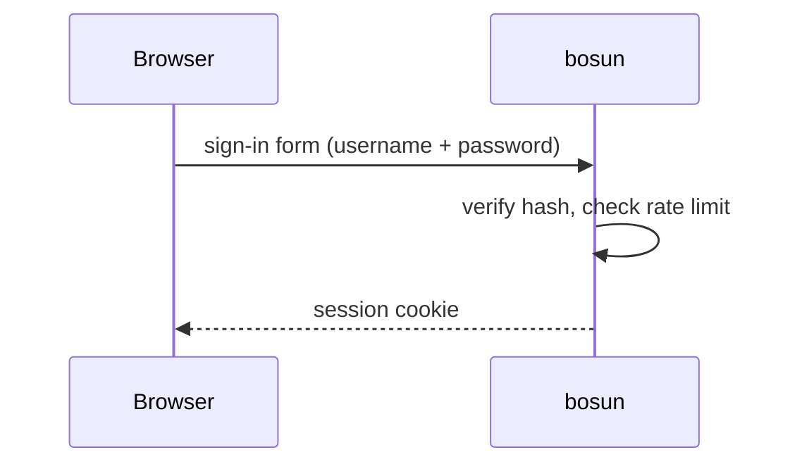
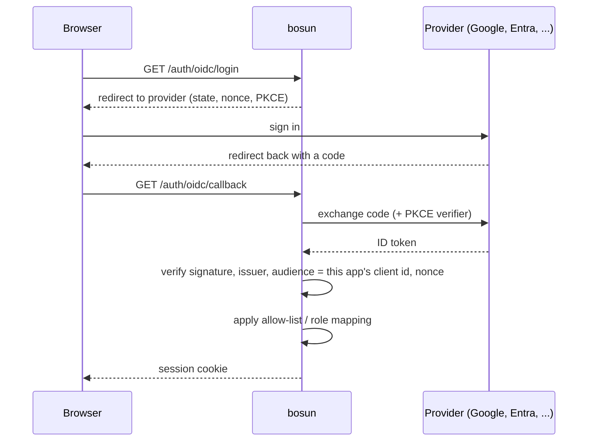
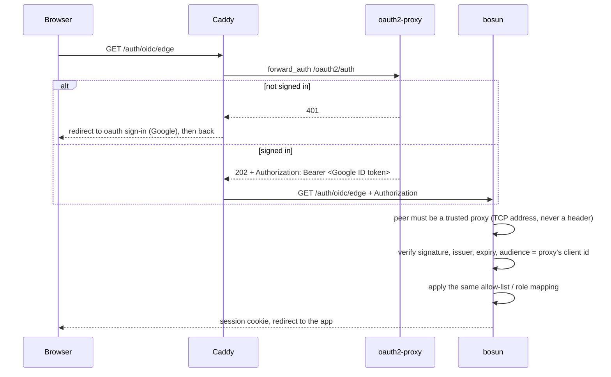

# Login flows: bosun

Bosun has local accounts (argon2id) with a one-time setup code for the first admin, API tokens for scripts, and, optionally, OpenID Connect and Edge SSO. TOTP is planned (WP-39) and is not built yet.

| Flow | What it is here |
|---|---|
| Password | Username and password (argon2id, 12+ characters); failed sign-ins are rate-limited per address and per user; a missing user costs the same hashing time as a wrong password. API tokens (`Authorization: Bearer`) are for scripts and the CLI. |
| TOTP | Not built yet. |
| OpenID Connect | The app is its own OIDC client. Routes: `GET /auth/oidc/login`, `GET /auth/oidc/callback`. |
| **Edge SSO** | The front door signs the person in and hands the app a signed Google ID token. Route: `GET /auth/oidc/edge`. |

## The flows

### Password


### OpenID Connect (the app's own client)


### Edge SSO (signed in at the front door)

If the app refuses (not on the list, bad token, untrusted peer) the person lands on the normal sign-in page with a message, and every other method still works.

## Edge SSO

Edge SSO is the name for "the reverse proxy already signed this person in, so do not ask again". It differs from a trusted-header scheme in one way that matters: the app does not believe a header. It receives the provider's **signed ID token** and checks it itself, so a forged request cannot pass as a signed-in person.

What the app checks, in order:

1. The route exists only when the audience is configured (otherwise 404).
2. The TCP peer is a trusted proxy (never `X-Forwarded-For`).
3. The token is signed by the provider's published keys with an asymmetric algorithm (RS256); `alg: none` and HMAC are refused.
4. Issuer, expiry and **audience = the proxy's client id** (not this app's own client id, so a token minted for the app's own login does not work here).
5. The email is verified by the provider and on this app's own allow-list; the role comes from the app's own mapping, never from the proxy.
6. Failures count against the sign-in rate limit and are logged; the person is sent to the normal sign-in page.

It never counts as a fresh or step-up sign-in, and it never replaces the app's other methods.

## Configuration

| Setting | Where |
|---|---|
| OIDC | `[api.sso]` in the config file: `issuer`, `client_id`, `public_url`, `name`, `email_roles` (`"you@example.com" = "admin"`); the secret is `BOSUN_OIDC_CLIENT_SECRET` |
| Edge SSO audience | `[api.sso] edge_audience` |
| Trusted proxies | `[api.sso] edge_trusted_proxies` |
| Who may sign in | `email_roles` maps verified addresses to admin / tester / viewer. An empty list lets nobody in. A role change in the list applies at the next sign-in; the last admin is never demoted. |

```toml
[api.sso]
issuer = "https://accounts.google.com"
client_id = "....apps.googleusercontent.com"
public_url = "https://bosun.example.com"
name = "Google"
edge_audience = "<oauth2-proxy client id>"      # optional: Edge SSO
edge_trusted_proxies = ["172.21.0.0/16"]        # required with edge_audience

[api.sso.email_roles]
"you@example.com" = "admin"
```

The audience is the Google client id used by `oauth2-proxy` (the `oauth` stack). The Caddy side is the `edge_sso` snippet; see `~/docker/docs/edge-sso.md` for the shared spec, including the Caddy route for this app (host: (not exposed through Caddy yet)).

## Notes

SSO accounts are stored with a non-verifying password hash, so they can never sign in with a password. These routes live outside `/api/` on purpose: the browser arrives through a cross-site redirect, which the API's `Sec-Fetch-Site` rule refuses.

## Tests

`crates/bosun-api/tests/sso.rs`.
